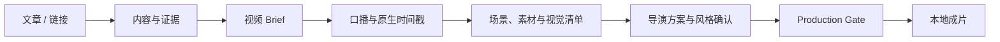

# Shin-video

将文章、新闻链接或长文制作成带口播、字幕、证据素材、导演方案和 Remotion 动效的本地短视频。

Shin-video 不把正文直接堆成卡片。它先生成视频 Brief、口播、时间轴、素材清单和导演方案，再通过质量门禁交给 Remotion 渲染。



## 使用方式

面向 Codex 使用时，安装仓库中的 `shin-video` 插件，并直接调用：

```text
用 Shin-video 把这篇文章做成短视频，先给我导演方案审核。
```

唯一推荐入口是 `$shin-video-director`。它会根据你提供的是文章、口播文案还是音频，自动进入对应阶段。

安装、TTS 配置和首次制作说明见：

- [插件说明](plugins/shin-video/README.md)
- [首次使用](plugins/shin-video/references/规范/getting-started.md)
- [TTS 与 Remotion 配置](plugins/shin-video/references/规范/TTS服务商与Remotion部署说明.md)

## 本地引擎

仓库根目录保存实际运行的 Next.js 与 Remotion 引擎。复制 `.env.local.example` 为 `.env.local`，配置至少一个可返回“最终音频 + 原生时间戳”的 TTS 服务商，然后运行：

```bash
npm install
npm run doctor
```

默认成片输出到仓库内的 `./outputs/`，该目录不会被 Git 跟踪。你可以在 `.env.local` 里将 `DEFAULT_OUTPUT_ROOT` 改为任意本地目录。

## 仓库结构

```text
app/                 Web API
components/          编辑器界面
lib/                 工作流与渲染逻辑
remotion/            视频组件与动画
plugins/shin-video/  可安装的 Codex 插件
scripts/             引擎检查与渲染命令
test/                自动化测试
```

## 本地文件

真实 API Key、输出视频和运行时缓存只保存在本地，不会提交到仓库。可安装插件只包含运行所需的规则、模板、资源与配置示例。
