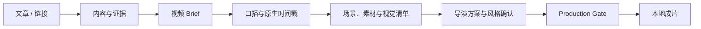

# Zimika Video Flow

将文章、新闻链接或长文制作成带口播、字幕、证据素材、导演方案和 Remotion 动效的本地短视频。

GitHub: https://github.com/zimika0520/Zimika-Video-Flow

Zimika Video Flow 是 Zimika 的二次开发作品，核心代码来自 [Shin-video](https://github.com/Shinchan-crayon/Shin-video)。它不把正文直接堆成卡片，而是先生成视频 Brief、口播、时间轴、素材清单和导演方案，再通过质量门禁交给 Remotion 渲染。来源与使用边界见 [UPSTREAM.md](UPSTREAM.md)。

当前版本：`0.3.0-zimika.1`



## 使用方式

面向 Codex 使用时，安装仓库中的插件，并直接调用：

```text
用 Zimika Video Flow 把这篇文章做成短视频，先给我导演方案审核。
```

插件内部继续保留 `shin-video` 标识以兼容既有脚本和测试，公开展示名称统一为 Zimika Video Flow。

安装、TTS 配置和首次制作说明见：

- [插件说明](plugins/shin-video/README.md)
- [首次使用](plugins/shin-video/references/规范/getting-started.md)
- [TTS 与 Remotion 配置](plugins/shin-video/references/规范/TTS服务商与Remotion部署说明.md)

## Production Handoff Brief

视频制作中断后，先运行接手诊断：

```bash
npm run handoff-brief -- --run-dir=/path/to/RUN_DIR
```

它会逐个检查视频 Brief、场景、素材清单、视觉清单、导演方案、风格配置、服务商原生字幕时间轴、最终音频和口播文案，然后按以下顺序返回唯一首要动作：

```text
修复损坏文件 → 补齐缺失文件 → 处理 Production Gate 错误 → 允许渲染
```

诊断结果写入 `RUN_DIR/production-handoff-brief.json`，不会修改任何视频制品。只有 `readiness.canRender=true` 且 `recommendedAction.kind=render_video` 时，才表示可以进入最终 Remotion 渲染。

## 本地引擎

仓库根目录保存实际运行的 Next.js 与 Remotion 引擎。复制 `.env.local.example` 为 `.env.local`，配置至少一个可返回“最终音频 + 原生时间戳”的 TTS 服务商，然后运行：

```bash
npm install
npm run doctor
```

默认成片输出到仓库内的 `./outputs/`，该目录不会被 Git 跟踪。你可以在 `.env.local` 里将 `DEFAULT_OUTPUT_ROOT` 改为任意本地目录。

## 仓库结构

```text
app/                 Web API
components/          编辑器界面
lib/                 工作流与渲染逻辑
remotion/            视频组件与动画
plugins/shin-video/  可安装的 Codex 插件
scripts/             引擎检查与渲染命令
test/                自动化测试
```

## 本地文件

真实 API Key、输出视频和运行时缓存只保存在本地，不会提交到仓库。可安装插件只包含运行所需的规则、模板、资源与配置示例。

## Zimika 的工程整理

- 统一应用、插件市场、页面标题和展示素材的品牌。
- 新增 `Production Handoff Brief`，把 9 个渲染输入的缺失、损坏、门禁错误和安全下一步汇总为稳定 JSON 契约。
- 增加 `LEARNING_GUIDE.md`，覆盖安装、测试、页面启动、核心链路和面试讲法。
- 保留完整测试与构建流程；当前本地验证为 571 项测试通过，Next.js 生产构建成功。
- 保留上游来源、作者和授权说明，不把上游实现整体冒充为从零原创。

完整更新记录见 [CHANGELOG.md](CHANGELOG.md)。

## 快速验证

```bash
npm ci
npm test -- --run
npm run build
```

真实生成视频前还需要配置支持原生时间戳的 TTS 服务、FFmpeg 和 `.env.local`。不要提交任何 API Key。
