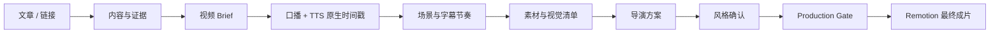

# Shin-video

把文章、新闻链接、公众号正文或本地长文，制作成带口播、底部字幕、外部证据素材、导演镜头方案和 Remotion 动效的本地视频。

它不把文章直接变成文字卡片。先确定观众、观点、素材证据和画面功能，再生成可执行导演方案，最后交给本地引擎渲染。



## 适合谁

- 想把文章稳定做成口播短视频的创作者或内容团队。
- 希望先审核导演方案，再渲染成片的人。
- 需要字幕、画面、证据素材和音频严格对齐的本地工作流使用者。

## 公开入口

唯一公开入口是 `$shin-video`。你可以直接说：

```text
用 Shin-video 把这篇文章做成短视频，先给我导演方案审核。
```

Shin-video 会判断当前材料是否只有文章、是否已有口播文案、是否已配置 TTS，并在内部完成文章处理、素材、导演、风格、门禁和渲染。用户无需安装、调用或理解额外阶段 Skill。

## 你提供什么

至少提供以下任意一种：

- 一篇文章链接或文章正文。
- 已确认的口播文案。
- 已配置的 TTS 服务商与音色偏好。
- 已有音频时，必须同时提供同一次 TTS 请求返回的原生时间戳。

## 你得到什么

```text
<输出目录>/YYYY-MM-DD/<视频标题>/
├── <视频标题>.mp4
├── 口播文案.md
├── publishing-pack.md
└── _runtime/<run-id>/
    ├── video-brief.json
    ├── subtitle-timeline.json
    ├── scenes.json
    ├── asset-manifest.json
    ├── visual-manifest.json
    ├── director-plan.json
    └── style-profile.json
```

`_runtime` 中保留可追溯的制作文件；缓存和可选预览属于临时材料，成功交付后由引擎自动清理。最终 MP4、口播文案和导演交付物会保留。

## 安装与首次配置

这个插件负责工作流，不复制第二套渲染引擎。插件不定义单独的安装命令；请通过当前使用的插件分发方式安装。Shin-video 运行引擎仍保留在仓库根目录，安装插件后还需要准备本地引擎、Node.js、FFmpeg、Remotion 和一个能返回“最终音频 + 原生时间戳”的 TTS 服务商。

1. 配置 `SHIN_VIDEO_ENGINE_ROOT`、`DEFAULT_OUTPUT_ROOT` 和 TTS 凭据。
2. 在 `SHIN_VIDEO_ENGINE_ROOT` 指向的引擎根目录，按该引擎现有的 `package.json` 安装依赖。
3. 首次安装、更新引擎或排查环境问题时，在该引擎根目录运行 `npm run doctor`。
4. 日常制作直接用 `$shin-video` 提交文章开始制作。

`npm run doctor`、`npm run test`、`npm run build` 和 `npm run verify-workflow` 是安装、更新、发布或故障排查工具，不是每条视频的制作步骤。

详细步骤见 [首次使用](references/规范/getting-started.md) 和 [TTS 与 Remotion 配置](references/规范/TTS服务商与Remotion部署说明.md)。

项目交付目录以 [项目文件结构](templates/交付/项目文件结构.md) 为准。

## 工作流规则

- 字幕正文始终来自确认后的口播文案；时间位置始终来自最终音频的服务商原生时间戳。
- 关键镜头必须有素材、来源卡或可复核结构图支撑。
- 每个镜头需要画面目标、字幕安全区和重叠风险说明。
- 没有导演方案、风格确认或最小 Production Gate 通过结果时，不渲染。
- 风格不会被静默默认；用户决定比例与画面方向。
- 正常制作直接渲染最终 MP4；只有用户明确要求审片时才生成预览。
- 成片前只执行最终音频/时间轴一致性、导演方案/场景指纹、风格配置和基础媒体有效性检查；Brief、素材、视觉清单等质量规则不再重复检查。

## 内部模块

插件对外只提供 `shin-video`。文章处理、证据采集、口播、音频校验、场景、素材、导演、风格、门禁和渲染作为内部模块运行，规则位于 `references/工作流模块/`。

## 引擎配置示例

复制 [config.example.json](config.example.json)，填写本地引擎和输出路径。不要将 API Key、输出视频、缓存或个人绝对路径提交进插件。

## 文件边界

插件目录只保留安装和运行所需的 Skill、规范、模板、资源和配置示例。API Key、输出视频、缓存和运行时文件都不会被提交进插件。
